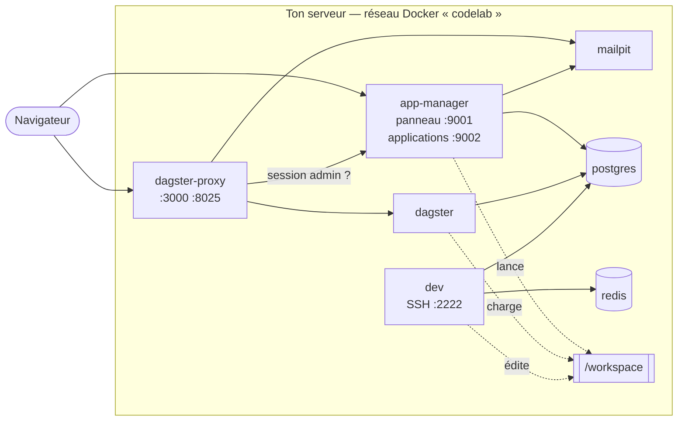

# CodeLab

**Un environnement de développement auto-hébergé, en un seul `docker-compose.yml`.** Il installe sur
ton serveur tout ce qu'il faut pour écrire, faire tourner et partager des applications :

- une base de données ;
- un cache ;
- un service de mails ;
- un accès SSH et VS Code ;
- un orchestrateur de tâches ;
- un **panneau** qui déploie, surveille et ouvre tes applications.

On écrit son code dans `/workspace`, on le déclare dans le panneau, il est en ligne. On peut ensuite
le partager : une invitation par mail, et la personne n'ouvre que ce que tu lui autorises.

## Ce que fait CodeLab

| Besoin | Ce que CodeLab fournit |
|---|---|
| Écrire du code | un conteneur SSH prêt pour VS Code Remote, avec Python, Node, git, `psql`, Codex, et l'outil `codelab` qui crée un projet en une commande |
| Le mettre en ligne | le panneau détecte les commandes de build et de lancement, construit, lance, relance après un crash, et sert l'application sur sa propre adresse |
| Stocker | Postgres (une base par projet, pgvector inclus) et Redis, déjà configurés partout |
| Envoyer des mails | Mailpit garde chaque mail consultable et le relaie par ton serveur d'envoi ; les applications n'ont aucun identifiant à connaître |
| Planifier des tâches | Dagster charge tout `definitions.py` des projets, sans fichier central |
| Partager | comptes invités, second facteur obligatoire, applications privées ou publiques, connexion avec CodeLab (SSO) |
| Surveiller | alertes par mail, journal des accès, diagnostic de l'installation, audit hebdomadaire des dépendances |
| Ne rien perdre | sauvegardes quotidiennes des bases et du panneau, archive hebdomadaire du code, restauration d'essai |

Le détail de chaque fonctionnalité : **[`docs/FONCTIONNALITES.md`](docs/FONCTIONNALITES.md)**.

## Comment



| Service | Rôle | Port publié |
|---|---|---|
| **app-manager** | Le panneau : comptes, déploiement, supervision. Il sert aussi les applications, sur une autre origine | `9001` (panneau), `9002` (applications) |
| **dagster-proxy** | Exige la session d'administration du panneau devant Dagster et Mailpit | `3000`, `8025` |
| **dagster** | Orchestrateur : interface et daemon (plannings, capteurs) | aucun |
| **mailpit** | Garde et relaie tous les mails | aucun (interface par le proxy) |
| **postgres** | Une base par projet, pgvector, sauvegardes quotidiennes | aucun |
| **redis** | Cache, sessions, files de tâches partagés | aucun |
| **dev** | Poste de développement SSH et VS Code | `2222` |

Quatre principes :

- **`/workspace` est le seul dossier de travail.** Les trois services qui en ont besoin le partagent.
- **Rien n'est à configurer.** Mots de passe, clés et connexions sont générés au premier démarrage
  dans `credentials.env`.
- **Toutes les données vivent hors des conteneurs**, dans `/DATA/AppData/codelab/`. Elles survivent
  aux mises à jour.
- **La sécurité est au plus strict par défaut.** Voir [`SECURITE.md`](SECURITE.md).

## Installer

**Prérequis** : Docker Engine avec le plugin Compose, 4 Go de mémoire, 2 cœurs, environ 3 Go de disque
plus tes projets.

```bash
git clone https://github.com/studio-codelab/codelab.git && cd codelab
docker compose up -d
```

1. **Mot de passe administrateur** : `sudo grep APP_MANAGER_ADMIN_PASSWORD /DATA/AppData/codelab/config/credentials.env`.
2. **Panneau** : `http://<serveur>:9001/`. Identifiant `admin`, puis enregistrement du second facteur.
3. **SSH** : dépose ta clé publique dans `/DATA/AppData/codelab/config/ssh/authorized_keys.d/` (un
   fichier par machine), puis `ssh vscode@<serveur> -p 2222`.
4. **Serveur d'envoi** : *Paramètres > E-mail* (un compte Gmail avec mot de passe d'application suffit).
   Il est nécessaire pour inviter quelqu'un.

**Avec CasaOS ou une interface d'import de compose** : utilise `docker-compose-casaos.yml`. C'est le
même fichier sans commentaires ; colle-le en remplaçant **tout** le contenu de la zone.

**Mettre à jour** : `docker compose pull && docker compose up -d`. Le nom du projet Compose est fixé à
`codelab`. Si une installation existe sous un autre nom, fais `docker compose down` avant.

**Taille de la machine** : aucun service ne dépasse le tiers de la mémoire, pour que le panneau reste
joignable si une application s'emballe. Sur une machine plus grande, remonte les plafonds dans les
deux fichiers compose, ainsi que `RAM_CIBLE_MO` dans `workspace/diagnostic/checks.py`.

## Utiliser

**Créer un projet et le mettre en ligne**

```bash
ssh vscode@<serveur> -p 2222
codelab new mon-projet --db      # dossier, git, base, manuel de l'agent, modules SSO et erreurs
cd /workspace/mon-projet         # puis coder (codex, ou VS Code)
```

1. Dans le panneau : *Applications > Ajouter un projet*, choisir le dossier. Les commandes sont
   proposées.
2. Activer l'application. Elle est servie sur `http://<serveur>:9002/mon-projet/`.
3. À chaque modification : **Déployer**, qui fait le build puis la remise en ligne.

**Partager** : *Utilisateurs > Inviter quelqu'un*, puis cocher les applications dans sa fiche.

**Planifier une tâche** : un `definitions.py` qui expose `defs` dans le projet. Dagster
(`http://<serveur>:3000/`) le découvre au prochain *Reload*.

**Vérifier l'installation** : la tuile *Diagnostic* du hub.

## Où vit la configuration

| Fichier (sur l'hôte) | Contenu | Écrit par |
|---|---|---|
| `/DATA/AppData/codelab/config/credentials.env` | les secrets des services, un bloc par service | les services, à leur démarrage |
| `/DATA/AppData/codelab/app-manager/codelab.db` | comptes, applications, droits, journal, réglages (les sensibles chiffrés) | le panneau |
| `/DATA/AppData/codelab/config/ssh/authorized_keys.d/` | une clé publique par machine autorisée | toi |
| `/workspace/<projet>/.env` | la configuration d'un projet ; elle l'emporte sur le reste | toi |

**Sauvegarde `credentials.env` à part.** Il contient `APP_MANAGER_CHIFFREMENT_CLE`, sans laquelle
les réglages chiffrés sont illisibles.

## Documentation

| Document | Pour |
|---|---|
| [`docs/FONCTIONNALITES.md`](docs/FONCTIONNALITES.md) | toutes les fonctionnalités, et où elles sont détaillées |
| [`SECURITE.md`](SECURITE.md) | ce que CodeLab garantit, comment, ses limites ; la liste de mise en production |
| [`dev/README.md`](dev/README.md) | le poste de développement : SSH, VS Code, `codelab`, git, Codex |
| [`dev/AGENTS.md`](dev/AGENTS.md) | les règles qu'un projet doit suivre pour s'intégrer au hub ; lu par les agents de code |
| [`workspace/README.md`](workspace/README.md) | anatomie d'un projet, configuration, base, dépendances |
| [`app-manager/README.md`](app-manager/README.md) | le panneau : applications, comptes, mails, API |
| [`app-manager/vps/README.md`](app-manager/vps/README.md) | exposer CodeLab sur Internet par un VPS |
| [`postgres/README.md`](postgres/README.md) | bases, sauvegardes, **restauration** |
| [`redis/README.md`](redis/README.md) · [`mailpit/README.md`](mailpit/README.md) · [`dagster/README.md`](dagster/README.md) · [`dagster/proxy/README.md`](dagster/proxy/README.md) | les autres services |
| [`workspace/diagnostic/README.md`](workspace/diagnostic/README.md) | le diagnostic et le projet modèle |

## Développer CodeLab

- **Tests** : `python3 -m pytest workspace/diagnostic/test_regressions.py -q`. Ils ont besoin de
  `flask psutil pytest webauthn qrcode cryptography pyyaml`.
- **CI** : à chaque pull request, les tests puis la construction des sept images. À chaque fusion sur
  `main`, publication sur GHCR en `latest`. Un tag `vX.Y.Z` publie une version.
- **Règle du dépôt** : aucune logique shell dans le compose. Elle vit dans l'entrypoint versionné de
  chaque service. Le fichier CasaOS ne porte aucun commentaire ; tout s'explique dans
  `docker-compose.yml` et dans les README.
