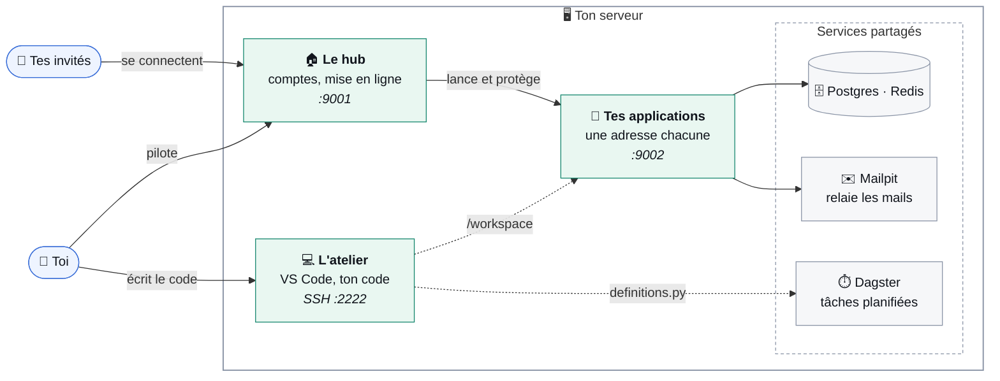

# CodeLab

**Ton atelier de développement, chez toi, en un seul `docker-compose.yml`.** CodeLab installe sur ton
serveur de quoi écrire une application, la mettre en ligne et la partager — sans rien configurer à la
main.

- **Tu codes** dans VS Code, connecté au serveur.
- **Tu mets en ligne** d'un clic, depuis un hub qui ressemble à un écran d'accueil.
- **Tu partages** : une invitation par mail, et chacun n'ouvre que ce que tu lui autorises.
- **Ils te répondent** : un message, une capture ou une maquette, que tu ranges en projets et en
  tâches, jusqu'à la feuille de route.

## En un coup d'œil



Tout reste sur ton serveur : le code, les bases, les mails, les sauvegardes.

## Ce que fait CodeLab

| Besoin | Ce que CodeLab fournit |
|---|---|
| Écrire du code | VS Code relié au serveur, avec Python, Node, git, Codex, et `codelab create` qui crée un projet en une commande (`codelab update` le tient à jour) |
| Le mettre en ligne | le hub détecte comment construire et lancer le projet, le relance s'il plante, et lui donne sa propre adresse |
| Stocker | une base Postgres par projet (et un cache Redis), déjà branchées |
| Envoyer des mails | les applications envoient sans identifiant à connaître ; chaque mail reste consultable |
| Planifier des tâches | un fichier `definitions.py` dans le projet, et Dagster le fait tourner |
| Partager | invitations par mail, Face ID / Touch ID ou code par mail, applications privées ou publiques |
| Échanger | messages avec captures et maquettes, projets, planning, feuille de route, export complet |
| Surveiller | alertes par mail, journal des accès, diagnostic de l'installation |
| Ne rien perdre | sauvegardes quotidiennes, archive hebdomadaire du code, restauration d'essai |

Le détail de chaque fonctionnalité : **[`FONCTIONNALITES.md`](FONCTIONNALITES.md)**.

Quatre principes :

- **Un seul dossier de travail**, `/workspace` : le code de tous tes projets.
- **Rien à configurer.** Mots de passe, clés et connexions sont créés au premier démarrage.
- **Les données vivent hors des conteneurs**, dans `/DATA/AppData/codelab/` : elles survivent aux
  mises à jour.
- **La sécurité est au plus strict par défaut.** Voir [`SECURITE.md`](SECURITE.md).

## Installer

**Prérequis** : Docker Engine avec le plugin Compose, 4 Go de mémoire, 2 cœurs, environ 3 Go de disque
plus tes projets.

```bash
git clone https://github.com/studio-codelab/codelab.git && cd codelab
docker compose up -d
```

1. **Mot de passe administrateur** : `sudo grep APP_MANAGER_ADMIN_PASSWORD /DATA/AppData/codelab/config/credentials.env`.
2. **Panneau** : `http://<serveur>:9001/`. Identifiant `admin`, puis Face ID / Touch ID ou une
   application de codes pour le second facteur.
3. **SSH** : dépose ta clé publique dans `/DATA/AppData/codelab/config/ssh/authorized_keys.d/` (un
   fichier par machine), puis `ssh vscode@<serveur> -p 2222`.
4. **Serveur d'envoi** : *Paramètres > E-mail* (un compte Gmail avec mot de passe d'application suffit).
   Il est nécessaire pour inviter quelqu'un.

**Avec CasaOS ou une interface d'import de compose** : utilise `docker-compose-casaos.yml`. C'est le
même fichier sans commentaires ; colle-le en remplaçant **tout** le contenu de la zone.

**Mettre à jour** : *Paramètres > Compte* montre la version installée, un lien vers ses nouveautés
sur GitHub et les commandes à copier. En bref :
`docker compose pull && docker compose up -d` (si `pull` saute des images, tire-les une à une avec
`docker pull`). Le nom du projet Compose est fixé à
`codelab`. Si une installation existe sous un autre nom, fais `docker compose down` avant.

**Taille de la machine** : aucun service ne dépasse le tiers de la mémoire, pour que le panneau reste
joignable si une application s'emballe. Sur une machine plus grande, remonte les plafonds dans les
deux fichiers compose, ainsi que `RAM_CIBLE_MO` dans `workspace/diagnostic/checks.py`.

## Utiliser

**Créer un projet et le mettre en ligne**

```bash
ssh vscode@<serveur> -p 2222
codelab create mon-projet       # dossier, git, base, manuel de l'agent, modules SSO et erreurs
cd /workspace/mon-projet         # puis coder (codex, ou VS Code)
```

1. Dans le panneau : *Applications > Ajouter un projet*, choisir le dossier. Les commandes sont
   proposées.
2. Activer l'application. Elle est servie sur `http://<serveur>:9002/mon-projet/`, ou sur
   `https://mon-projet.<domaine>/` derrière un VPS (voir [Les ports](#les-ports)).
3. À chaque modification : **Build** puis **Redémarrer**, dans la fiche de l'application.

**Partager** : *Utilisateurs > Inviter quelqu'un*, puis cocher les applications dans sa fiche.

**Planifier une tâche** : un `definitions.py` qui expose `defs` dans le projet. Dagster
(`http://<serveur>:3000/`) le découvre au prochain *Reload*.

**Vérifier l'installation** : la tuile *Diagnostic* du hub.

## Où vit la configuration

| Fichier (sur l'hôte) | Contenu | Écrit par |
|---|---|---|
| `/DATA/AppData/codelab/config/credentials.env` | les secrets des services, un bloc par service | les services, à leur démarrage |
| `/DATA/AppData/codelab/app-manager/codelab.db` | comptes, applications, droits, journal, réglages (les sensibles chiffrés) | le panneau |
| `/DATA/AppData/codelab/config/ssh/authorized_keys.d/` | une clé publique par machine autorisée | toi |
| `/workspace/<projet>/.env` | la configuration d'un projet ; elle l'emporte sur le reste | toi |

**Sauvegarde `credentials.env` à part.** Il contient `APP_MANAGER_CHIFFREMENT_CLE`, sans laquelle
les réglages chiffrés sont illisibles.

## Sous le capot

Sept services Docker, sur un réseau privé `codelab`. Seuls le panneau, Dagster/Mailpit (derrière la
session d'administration) et SSH sont publiés.

| Service | Rôle | Port publié |
|---|---|---|
| **app-manager** | Le panneau : comptes, déploiement, supervision. Il sert aussi les applications, sur une autre origine | `9001` (panneau), `9002` (toutes les applications) |
| **dagster-proxy** | Exige la session d'administration du panneau devant Dagster et Mailpit | `3000`, `8025` |
| **dagster** | Orchestrateur : interface et daemon (plannings, capteurs) | aucun |
| **mailpit** | Garde et relaie tous les mails | aucun (interface par le proxy) |
| **postgres** | Une base par projet, pgvector, sauvegardes quotidiennes | aucun |
| **redis** | Cache, sessions, files de tâches partagés | aucun |
| **dev** | Poste de développement SSH et VS Code | `2222` |

Le panneau, Dagster et le poste de développement partagent `/workspace` : le poste y écrit le code,
le panneau y lance les applications, Dagster y charge les `definitions.py`.

### Les ports

- **Toutes les applications passent par le `9002`**, chacune sous `/<nom>/` (derrière un VPS : un
  sous-domaine par application, `<nom>.<domaine>`). C'est une autre origine que le panneau.
- Derrière, chacune écoute sur un **port interne** (`$PORT`, de `9101` à `9140`) que le panneau
  relaie ; ces ports ne sont pas publiés.
- Si le `9002` ne s'ouvre pas, ou si `APP_MANAGER_APPS_PORT` vaut `0`, les applications reviennent
  sous `:9001/<nom>/`, dans l'origine du panneau, et le diagnostic le signale.
- **Dagster (`3000`) et Mailpit (`8025`)** ne sont pas des applications du hub : ils ont leur port,
  derrière la session d'administration, et restent sur le réseau local.

## Documentation

| Document | Pour |
|---|---|
| [`FONCTIONNALITES.md`](FONCTIONNALITES.md) | toutes les fonctionnalités, et où elles sont détaillées |
| [`SECURITE.md`](SECURITE.md) | ce que CodeLab garantit, comment, ses limites ; la liste de mise en production |
| [`INCIDENTS.md`](INCIDENTS.md) | que faire si le panneau ou le serveur tombe, un compte est piraté, le disque est plein ; restaurer |
| [`dev/README.md`](dev/README.md) | le poste de développement : SSH, VS Code, `codelab`, git, Codex |
| [`dev/AGENTS.md`](dev/AGENTS.md) | les règles qu'un projet doit suivre pour s'intégrer au hub ; lu par les agents de code |
| [`workspace/README.md`](workspace/README.md) | anatomie d'un projet, configuration, base, dépendances |
| [`app-manager/README.md`](app-manager/README.md) | le panneau : applications, comptes, mails, API |
| [`app-manager/vps/README.md`](app-manager/vps/README.md) | exposer CodeLab sur Internet par un VPS |
| [`postgres/README.md`](postgres/README.md) | bases, sauvegardes, **restauration** |
| [`redis/README.md`](redis/README.md) · [`mailpit/README.md`](mailpit/README.md) · [`dagster/README.md`](dagster/README.md) · [`dagster/proxy/README.md`](dagster/proxy/README.md) | les autres services |
| [`workspace/diagnostic/README.md`](workspace/diagnostic/README.md) | le diagnostic et le projet modèle |

## Développer CodeLab

- **Consignes** : [`AGENTS.md`](AGENTS.md), pour un agent comme pour un humain. Il donne la méthode,
  la carte des dépendances, les règles de sécurité, les standards de code, les tests et la liste de
  contrôle avant de pousser.
- **Tests** : `python3 -m pytest workspace/diagnostic/tests -q`. Ils ont besoin de
  `flask psutil pytest webauthn qrcode cryptography pyyaml`.
- **CI** : à chaque pull request, les tests puis la construction des sept images. À chaque fusion sur
  `main`, publication sur GHCR en `latest`. Un tag `vX.Y.Z` publie une version.
- **Règle du dépôt** : aucune logique shell dans le compose. Elle vit dans l'entrypoint versionné de
  chaque service. Le fichier CasaOS ne porte aucun commentaire ; tout s'explique dans
  `docker-compose.yml` et dans les README.
