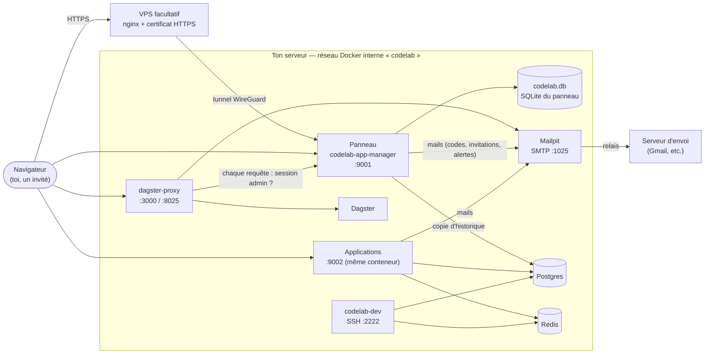

# CodeLab — Spécification et règles de sécurité

> **À qui s'adresse ce document.** À toi, pour décrire CodeLab en quelques minutes ; à quelqu'un à
> qui tu ouvres un compte, pour savoir ce qu'il devient ; et à quiconque modifie le code, pour
> connaître les règles qu'il ne doit pas casser. Les détails techniques sont dans les README de
> chaque service ; ici, l'essentiel, et ce qui fait foi.
>
> **Ce document se tient à jour avec le code.** Une règle ajoutée, retirée ou assouplie dans le code
> doit l'être ici dans la même modification. La suite de tests
> (`workspace/diagnostic/test_regressions.py`) vérifie la plupart de ces règles automatiquement.

---

## 1. CodeLab en une page

CodeLab est un **environnement de développement auto-hébergé** : un seul `docker-compose.yml`
installe sur ton serveur une base de données, un cache, un envoi de mails, un accès SSH/VS Code, un
orchestrateur de tâches et un **panneau** qui déploie et surveille tes applications.

On écrit son code dans `/workspace`, on le déclare dans le panneau, il est en ligne. On peut ensuite
**partager une application** avec quelqu'un en l'invitant : il reçoit un lien, se crée un accès, et
n'ouvre que ce que tu lui autorises.

**Ce que CodeLab garantit à une personne invitée :**

- elle n'ouvre **que les applications que l'administrateur lui a autorisées** ;
- son mot de passe n'est **jamais stocké** — seulement une empreinte impossible à inverser ;
- son adresse mail est **chiffrée** sur le serveur ;
- chaque connexion demande **un second facteur** : un code reçu par mail, ou Face ID / Touch ID ;
- elle n'a **aucun accès** à l'administration, à l'orchestrateur (Dagster) ni aux mails (Mailpit) ;
- tout est hébergé **sur le serveur de l'administrateur**, et nulle part ailleurs.

---

## 2. Architecture

### 2.1 Les services

| Service | Rôle | Port publié | Qui peut l'atteindre |
|---|---|---|---|
| **codelab-app-manager** (le panneau) | Connexion, comptes, déploiement et supervision des applications | `9001` | tout le monde (page de connexion) ; l'administration peut être limitée au réseau local |
| **Applications** | Les projets déployés, servis par le proxy du panneau | `9002` | selon la visibilité de chaque application : **publique** (lien partageable) ou **privée** (compte autorisé) |
| **codelab-dagster** + **codelab-dagster-proxy** | Orchestration des tâches planifiées | `3000` | **administrateur uniquement** |
| **codelab-mailpit** | Envoi des mails (panneau et applications), historique consultable | `8025` (interface) | **administrateur uniquement** ; le SMTP n'est joignable que depuis le réseau interne |
| **codelab-postgres** | Base de données partagée (une base par projet) + copie d'historique du panneau | aucun | réseau interne seulement |
| **codelab-redis** | Cache, sessions, files de tâches des applications | aucun | réseau interne seulement |
| **codelab-dev** | Accès SSH et VS Code Remote | `2222` | **clé SSH uniquement**, jamais de mot de passe |

### 2.2 Les liens entre services

**À retenir :**

- le **panneau est la porte d'entrée** : il authentifie, et il décide pour Dagster et Mailpit (le
  proxy lui demande, avant *chaque* requête, si la session est une session d'administration) ;
- les **applications vivent sur un autre port** que le panneau, donc dans une autre *origine* au
  sens du navigateur : un script d'une application ne peut pas lire le panneau ;
- **Postgres et Redis ne sont jamais publiés** sur le réseau : seuls les conteneurs de la stack les
  joignent ;
- **tous les mails passent par Mailpit**, qui les garde consultables et les relaie par ton serveur
  d'envoi.

### 2.3 À quoi sert Mailpit

Mailpit est le **bureau de poste** de CodeLab. Le panneau (codes de connexion, invitations,
alertes) et tes applications (inscriptions, notifications) lui remettent leurs mails ; il les
**garde** (les 500 derniers, un mois au plus) et les **relaie** par le serveur d'envoi réglé dans
*Paramètres > E-mail et alertes*. Ce qu'il apporte :

- **voir ce qui est parti** : chaque mail se relit, avec son destinataire et son rendu ;
- **un seul endroit pour le mot de passe d'envoi** : les applications envoient sans identifiants ;
- **un plafond d'envoi** (50 mails par heure, 200 par jour) : une application qui part en boucle ne
  fait pas suspendre ton compte d'envoi ;
- **un mode test** : tout est gardé, rien n'est envoyé.

**Si son interface est vide, c'est qu'aucun mail n'est encore passé par lui.** Une invitation
envoyée depuis *Utilisateurs* y apparaît aussitôt. Sans serveur d'envoi réglé, les mails y restent
sans partir — et c'est là que tu retrouves le lien d'une invitation à transmettre toi-même.

---

## 3. Comptes et rôles

| | Administrateur | Utilisateur invité |
|---|---|---|
| Création | au premier démarrage (mot de passe dans `credentials.env`) | **par invitation** de l'administrateur, uniquement |
| Ouvre | tout | **seulement** les applications privées autorisées, et les applications publiques |
| Déclarer, déployer, configurer | oui | non |
| Dagster, Mailpit | oui | **jamais** |
| Second facteur | **obligatoire** : application d'authentification ou Face ID / Touch ID | **obligatoire** : code par mail, application, ou Face ID / Touch ID |
| Durée maximale d'une session | **12 heures** | 30 jours (3 jours sans activité) |

**Il n'y a pas d'inscription libre.** Aucun formulaire public ne crée de compte.

---

## 4. Authentification

### 4.1 Inviter quelqu'un

1. L'administrateur saisit une adresse mail (*Utilisateurs > Inviter quelqu'un*).
2. Un lien part par Mailpit. Il est aussi **affiché à l'administrateur**, qui peut le transmettre
   lui-même.
3. La personne ouvre le lien, choisit son nom d'utilisateur et son mot de passe (12 caractères au
   moins), et entre. Son adresse est vérifiée du même coup.
4. Le panneau lui propose d'activer Face ID / Touch ID pour les connexions suivantes.

Le lien porte un **jeton aléatoire de 256 bits** ; le serveur n'en garde qu'une **empreinte**
(chiffrée). Il **ne sert qu'une fois** et **expire au bout de sept jours**. L'administrateur peut
le renvoyer (l'ancien lien cesse alors de fonctionner) ou l'annuler.

### 4.2 Se connecter

- **Face ID / Touch ID / empreinte / Windows Hello** (clé d'accès, norme WebAuthn) : un geste, ni
  mot de passe ni code. C'est le moyen le plus sûr : la clé ne signe que pour ce domaine, donc un
  faux site n'en tire rien. Exige HTTPS et un nom de domaine.
- **Mot de passe + code** : après le mot de passe, un code à six chiffres part par mail (ou est lu
  dans l'application d'authentification si la personne en a une). Le code vaut **10 minutes**,
  sert **une fois**, tolère **5 essais**, et ne part que vers l'adresse vérifiée du compte.

### 4.3 Mot de passe oublié

- Pour un compte qui a **Face ID ou une application d'authentification** : un code part par mail,
  et le **code par mail est ensuite suspendu** jusqu'à la prochaine connexion par Face ID ou par
  l'application.
- Pour tout autre compte : **c'est l'administrateur qui pose un nouveau mot de passe.**

**Pourquoi :** la boîte mail sert déjà de second facteur. Si elle servait aussi, à elle seule, à
changer le mot de passe, qui prendrait la boîte mail prendrait le compte.

### 4.4 Le compte administrateur

- Second facteur **obligatoire**. Sans facteur enregistré, le mot de passe juste mène à
  l'enregistrement du second facteur, pas à une session. **Première connexion** : un bouton
  « Activer Face ID / Touch ID » (dès que le panneau est servi en HTTPS sous un nom de domaine),
  rien à recopier. Sinon, un lien ouvre l'application de codes de l'appareil avec tout déjà
  rempli ; le QR code sert pour un autre appareil. Cette étape n'est ouverte que 10 minutes
  après le mot de passe, une seule fois, et depuis le réseau local si l'administration y est
  limitée.
- Session de **12 heures** au plus.
- **Alerte par mail** à chaque connexion depuis une adresse IP jamais vue.
- Peut être **limité au réseau local** (*Paramètres > Serveur > Réglages avancés*).
- Téléphone perdu : `APP_MANAGER_ADMIN_2FA: "0"` dans le compose, le temps de reprendre la main
  (voir `docker-compose.yml`).

---

## 5. Données

### 5.1 Où elles vivent

| Donnée | Emplacement | Protection |
|---|---|---|
| Comptes, droits, clés d'accès, applications, journal, messages | `codelab.db` (SQLite) dans le dossier d'état du panneau | fichier `0600`, lisible par le seul panneau |
| Adresses mail, serveur d'envoi, invitations, destinataires d'alerte | `codelab.db`, table `reglages_chiffres` | **chiffrées** (Fernet : AES-128 + HMAC-SHA256), clé dans `credentials.env` |
| Mots de passe des comptes | `codelab.db`, table `comptes` | **jamais stockés** : empreinte PBKDF2-HMAC-SHA256, 200 000 itérations, sel par compte |
| Identifiants des services, mot de passe admin, clé de chiffrement | `credentials.env` | `0600 root`, jamais transmis aux applications |
| Historique long (journal complet, copie des comptes) | Postgres, base `codelab` | ni empreinte de mot de passe, ni adresse en clair |
| Données de tes applications | leurs bases Postgres, Redis, leur dossier `/workspace/<projet>` | selon chaque application |

Le détail de chaque table est dans
[`app-manager/README.md`, section « Données »](../app-manager/README.md#donnees--la-base-codelabdb).

### 5.2 Durées de conservation

| Donnée | Conservation |
|---|---|
| Journal des connexions (local) | 50 000 derniers événements ; Postgres garde tout |
| Messages à l'administrateur | 5 000 derniers (les messages retenus ne partent jamais) |
| Mails dans Mailpit | 500 derniers, un mois au plus |
| Sauvegardes du panneau | 7 dernières archives quotidiennes (réglable) |
| Code de connexion / de réinitialisation | 10 / 15 minutes, une seule utilisation |
| Lien d'invitation | 7 jours, une seule utilisation |

### 5.3 Sauvegarde

Une archive quotidienne du dossier d'état (dont un **instantané cohérent** de la base, pris par
SQLite lui-même), vérifiée avant d'être gardée, en `0600`. Elle ne contient **pas**
`credentials.env` : sauvegarde **aussi** ce fichier, à part — sans la clé qu'il porte, les réglages
chiffrés sont illisibles.

---

## 6. Isolation des applications

- **Une autre origine** : les applications sont servies sur le port `9002`, le panneau sur `9001`.
  Un script d'une application ne peut ni lire la page du panneau, ni son jeton de sécurité.
- **Le cookie du panneau ne leur est jamais transmis** : le proxy le retire de chaque requête.
- **Pas en root** : les applications et leurs builds tournent sous un utilisateur dédié (`uid
  1001`), qui ne peut pas lire `credentials.env`.
- **Secrets transmis au strict nécessaire** : Postgres, Redis, Mailpit et la clé publique SSO —
  jamais le mot de passe du panneau, sa clé privée, ni le mot de passe d'envoi des mails.
- **Identité signée (SSO)** : une application sait qui la consulte grâce à une assertion signée
  **Ed25519**, valable 60 secondes et liée à cette application. Les en-têtes d'identité envoyés
  par le navigateur sont retirés avant d'ajouter les vrais.
- **Encadrement** : seul le panneau peut afficher une application dans un cadre
  (`frame-ancestors`).
- **Ressources bornées** : aucun service ne peut prendre plus du tiers de la mémoire du serveur.

---

## 7. Réseau et exposition

- **Postgres et Redis** ne sont pas publiés. **Le SMTP de Mailpit** non plus.
- **HTTPS** : indispensable dès que le panneau est joignable depuis Internet. Sans lui, Face ID ne
  fonctionne pas et le cookie de session circule en clair.
- **Recommandé : passer par un VPS** (*Paramètres > Serveur*) : le VPS porte le domaine et le
  certificat, ton serveur reste joignable seulement par un tunnel, rien n'est ouvert sur ta box.
- **Proxy de confiance** : derrière un proxy, l'adresse du visiteur est celle **ajoutée par le
  proxy** (la dernière de `X-Forwarded-For`), jamais celle que le visiteur annonce lui-même.
- **Ne publie pas sur Internet** les ports `3000` (Dagster), `8025` (Mailpit) et `2222` (SSH) sans
  en avoir besoin : ils sont protégés, mais moins exposé vaut mieux.

---

## 8. Conteneurs

- Six des sept services tournent avec `cap_drop: ALL` et `no-new-privileges` ; seules les
  capacités réellement utilisées sont rendues, une par une, justifiées dans le compose.
  `codelab-dev` en est exclu volontairement : c'est le shell de développement.
- Limites de mémoire, de processeur et de nombre de processus par service ; journaux Docker en
  rotation (3 × 10 Mo).
- Secrets générés aléatoirement au premier démarrage ; aucun mot de passe par défaut.

---

## 9. Surveillance et alertes

- **Journal des connexions** (*Utilisateurs > Connexions récentes*) : connexions, refus, ouvertures
  d'applications, avec l'adresse IP. Filtrable par type.
- **Alerte par mail** quand une application tombe et ne redémarre plus (5 tentatives en
  10 minutes), et quand elle revient.
- **Alerte par mail** à chaque connexion administrateur depuis une adresse inconnue.
- **Si le serveur entier tombe** : un service extérieur (healthchecks.io, gratuit) te prévient
  quand le serveur cesse de donner signe de vie.
- **Diagnostic** : une page d'état des lieux (sécurité, exposition, sauvegardes, applications) ;
  elle lit la base du panneau **en lecture seule**.

---

## 10. Règles de sécurité à ne jamais casser

Toute modification du code doit respecter ces règles. Chacune est couverte par au moins un test.

**Authentification**

1. Un compte utilisateur n'ouvre **jamais** de session sur le seul mot de passe.
2. Le compte administrateur exige un second facteur (sauf `APP_MANAGER_ADMIN_2FA=0`, marche
   arrière documentée).
3. Un code (connexion, vérification, réinitialisation) n'est stocké que sous forme d'**empreinte**,
   sert une fois, expire, et se limite à 5 essais.
4. Un code ne part **que** vers une destination enregistrée sur le compte, jamais vers une adresse
   fournie par la requête, et seulement après un mot de passe juste.
5. La boîte mail seule ne permet jamais de prendre un compte (voir 4.3).
6. Un compte qui a déjà un facteur ne peut pas en enregistrer un nouveau sur le seul mot de passe.
7. 5 échecs par 5 minutes et par adresse IP, au plus, sur toutes les routes de connexion.
8. Changer de mot de passe ou retirer les clés d'accès **ferme les autres sessions** du compte.
9. Ajouter une clé d'accès ou changer son adresse exige une connexion de **moins de 15 minutes**.
10. Un compte suspendu n'entre plus, par aucun moyen (mot de passe, code, Face ID), et sa session
    ouverte tombe à la requête suivante.
11. Les réponses ne révèlent pas si un compte existe (mot de passe oublié, échec de connexion).

**Accès**

12. Dagster et Mailpit ne s'ouvrent qu'à une session d'administration ; ils ne s'accordent à
    aucun compte.
13. Une application privée ne s'ouvre qu'à un compte autorisé ; les applications par défaut sont
    réservées à l'administrateur.
14. Toute route qui modifie quelque chose exige le jeton anti-falsification de la session (sauf
    les routes de connexion et d'invitation, qui n'ont pas encore de session).
15. Pas d'inscription libre : un compte ne naît que par invitation ou par l'administrateur.

**Données**

16. Aucun mot de passe, aucune adresse mail, aucun mot de passe d'envoi n'est écrit en clair sur
    le disque ; une donnée supprimée est effacée du fichier (`secure_delete`).
17. La base du panneau est en `0600` ; les archives de sauvegarde aussi.
18. Le diagnostic n'accède à la base qu'en lecture seule.

**Applications**

19. Les applications ne reçoivent jamais le cookie du panneau, son mot de passe, sa clé privée ni
    le mot de passe d'envoi des mails.
20. Les applications et leurs builds ne tournent jamais en root.
21. Une adresse IP n'est crue depuis `X-Forwarded-For` que derrière un proxy déclaré de confiance,
    et c'est la dernière entrée (celle du proxy) qui compte.

---

## 11. Ce que CodeLab ne protège pas

Pour rassurer honnêtement, il faut aussi dire les limites :

- **Une faille dans une de tes applications** reste une faille dans cette application : CodeLab
  l'isole du panneau et des autres secrets, il ne la corrige pas.
- **L'administrateur voit tout** : les applications, le journal des connexions, et les mails
  passés par Mailpit (codes compris). C'est son rôle ; il ne voit jamais un mot de passe.
- **Sans HTTPS**, une connexion depuis un réseau public peut être écoutée.
- **La sécurité de la boîte mail** de chaque utilisateur compte : elle reçoit ses codes. Face ID
  reste le moyen le plus sûr.
- **Le serveur lui-même** (système, mises à jour, accès physique) est sous ta responsabilité.

---

## 12. Mise en production : la liste

- [ ] HTTPS en place (VPS recommandé), « Proxy de confiance » coché si un proxy est devant.
- [ ] Face ID / Touch ID ou une application d'authentification activé sur le compte admin.
- [ ] « Administration réservée au réseau local » activée si tu n'administres pas à distance.
- [ ] Serveur d'envoi réglé (*Paramètres > E-mail et alertes*), adresse d'alerte renseignée.
- [ ] Surveillance externe (healthchecks.io) réglée.
- [ ] `credentials.env` sauvegardé **à part**, en lieu sûr.
- [ ] Ports `3000`, `8025`, `2222` non publiés sur Internet (sauf besoin).
- [ ] Page de diagnostic au vert.

---

## 13. Questions fréquentes

**Mon mot de passe est-il visible par l'administrateur ?**
Non. Le serveur n'en garde qu'une empreinte, impossible à inverser. L'administrateur ne peut que
t'en poser un nouveau.

**Où sont mes données ?**
Sur le serveur de l'administrateur, et nulle part ailleurs. CodeLab n'envoie rien à un service
tiers, à part les mails (via le serveur d'envoi choisi par l'administrateur) et, s'il l'a activé,
un signal de vie à healthchecks.io (sans aucune donnée personnelle).

**Que voit-on de moi ?**
Ton nom d'utilisateur, ton adresse mail, les applications que tu as le droit d'ouvrir, et le
journal de tes connexions (date, adresse IP, application ouverte).

**Pourquoi un code à chaque connexion ?**
Pour qu'un mot de passe volé ne suffise pas. Active Face ID / Touch ID : tu n'auras plus ni mot
de passe ni code à saisir.

**J'ai perdu mon téléphone.**
Préviens l'administrateur : il retire tes clés d'accès en un clic, ce qui ferme aussi tes sessions
ouvertes.
